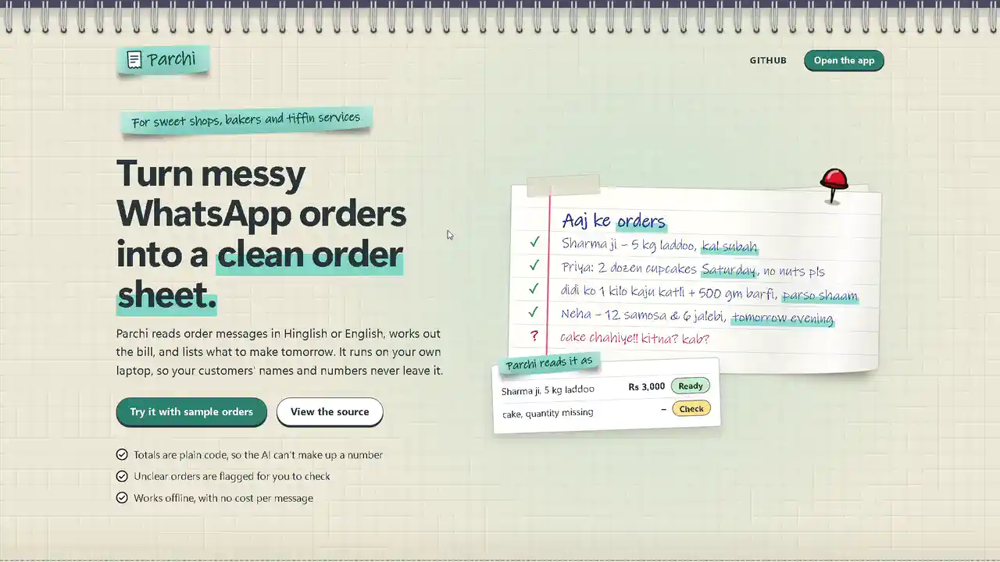
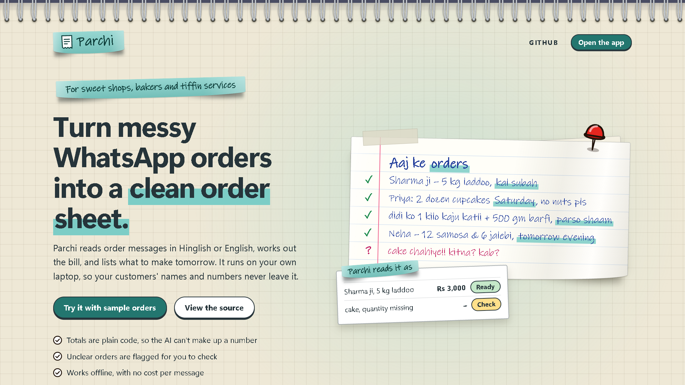
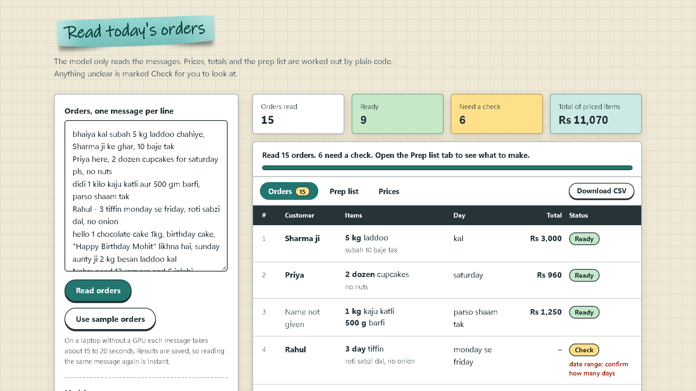
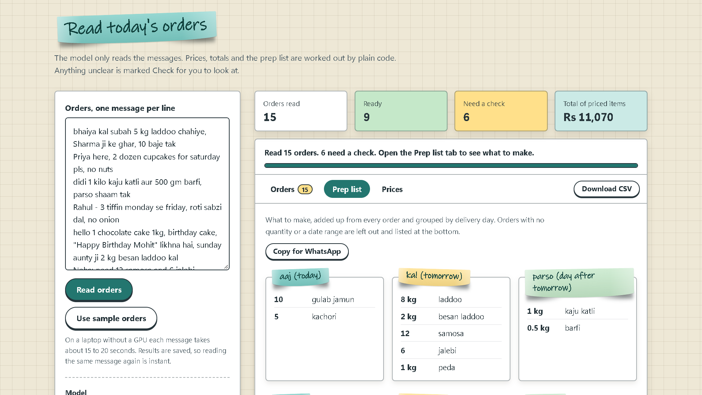
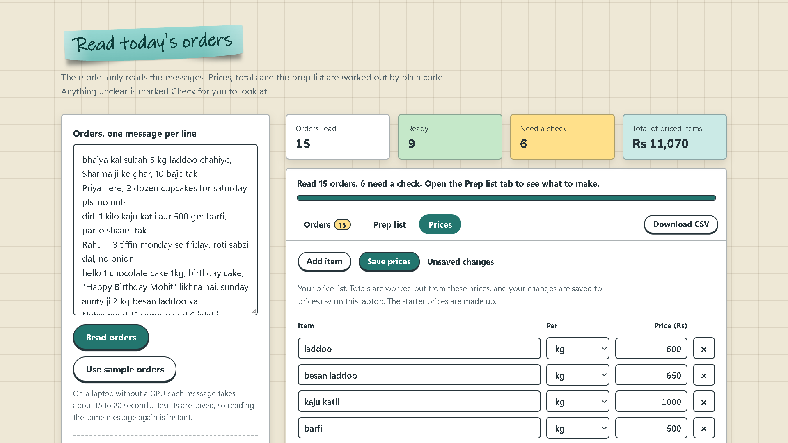
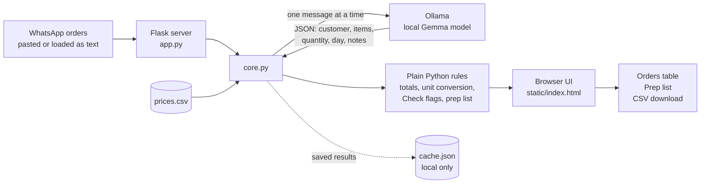

<div align="center">

# 🗐 Parchi

### Turn messy WhatsApp orders into a clean order sheet, totals and a prep list.

Built for home bakers, sweet shops and tiffin services. Runs fully on your own laptop with an open-weight Gemma model.

</div>

---

## Table of contents

- [Screenshots](#screenshots)
- [The problem](#the-problem)
- [The solution](#the-solution)
- [How it works](#how-it-works)
- [Key features](#key-features)
- [Built with](#built-with)
- [Prerequisites](#prerequisites)
- [Installation](#installation)
- [Usage](#usage)
- [Project structure](#project-structure)
- [Model notes: E4B vs E2B](#model-notes-e4b-vs-e2b)
- [Command-line scripts](#command-line-scripts)
- [License](#license)

---

## Screenshots

<p align="center">
  
</p>

<table>
  <tr>
    <td align="center"><br><sub>Home page</sub></td>
    <td align="center"><br><sub>Orders table with Check flags</sub></td>
  </tr>
  <tr>
    <td align="center"><br><sub>Prep list by day</sub></td>
    <td align="center"><br><sub>Editable price list</sub></td>
  </tr>
</table>

---
## The problem

A small food seller in India takes most of their orders on WhatsApp. The messages look like this:

```
bhaiya kal subah 5 kg laddoo chahiye, Sharma ji ke ghar, 10 baje tak
Priya here, 2 dozen cupcakes for saturday pls, no nuts
Amit 4 tiffin kal se, 1 me sirf roti sabzi
cake chahiye
```

They are written in a mix of Hindi and English, with no fixed format, and they pile up in a chat. At the end of the day the seller has to scroll back, work out who ordered what, add up the bill by hand, and decide how much to cook for tomorrow. A missed message or a wrong sum costs money and customers.

Tools that fix this usually send every customer's name and number to a cloud API, charge per message, and need internet.

## The solution

**Parchi** (a *parchi* is the slip of paper an order gets written on) reads those messages and turns each one into a row: customer, items, quantity, delivery day, notes, and a total in rupees. It then adds up what to make for each day.

The key design choice is a clear split of work:

- **The AI only reads.** A local Gemma model turns messy text into structured fields.
- **Plain Python does all the math.** Prices, totals and the prep list are ordinary code, so a number can never be made up by the model.
- **Unclear orders are flagged, not guessed.** A missing quantity, an item that is not in the price list, or an unclear day gets a `Check` status so the seller can look at it.

Everything runs on the seller's laptop through Ollama. Customer names and numbers never leave the machine, there is no per-message cost, and it works offline.

## How it works



**Step by step**

1. The seller pastes WhatsApp messages (one per line) into the page, or loads the sample orders.
2. For each message, `core.py` asks the local model for JSON only, and tells it to use `null` instead of guessing.
3. Plain Python matches each item against `prices.csv`, converts units (for example 250 gm to 0.25 kg) and calculates the total.
4. Rules mark an order as `Check` when something is missing or unclear: no quantity, an item not in the price list, a unit that does not match the price, no items found, an unclear delivery day, or a date range.
5. Orders are grouped by delivery day into a prep list, such as "make 8 kg laddoo" for tomorrow.
6. Results are saved in a local cache so reopening the page does not re-run the model.

## Key features

- **Reads Hinglish and English.** Handles messages like "didi 1 kilo kaju katli aur 500 gm barfi, parso shaam tak".
- **Totals the AI cannot get wrong.** The model never does arithmetic. Totals come from `prices.csv`.
- **Check flags.** Vague or incomplete orders are marked for review instead of being guessed.
- **Prep list by day.** Quantities for the same item are added across orders, with a one-click **Copy for WhatsApp** button.
- **Editable price list.** Edit, add or delete items in the Prices tab. Saving writes to `prices.csv` and updates totals.
- **Original message one click away.** Click any row to see the message it came from.
- **CSV download.** Export the order sheet to open in Excel or Google Sheets.
- **Model picker.** The page lists the models installed in your Ollama and defaults to `gemma4:e4b`.
- **Date ranges held back.** Orders like "monday se friday" or "kal se" get a Check stamp and are kept out of totals and the prep list, instead of being counted as one day.
- **Private by design.** Runs locally. No account, no API key, no data upload.

## Built with

| Part | Tool |
| --- | --- |
| Language model | [Gemma 4](https://ai.google.dev/gemma) (`gemma4:e4b`), open weights |
| Model runtime | [Ollama](https://ollama.com), local API on `localhost:11434` |
| Backend | Python and [Flask](https://flask.palletsprojects.com) |
| Frontend | One HTML file with plain CSS and JavaScript, no build step |
| Data | CSV and JSON files on disk |

## Prerequisites

- **Python 3.10 or newer**
- **Git**
- **[Ollama](https://ollama.com/download)** installed and running in the background
- About **6 GB of free disk space** for the model, and **16 GB RAM** recommended. No GPU is needed.

## Installation

```bash
# 1. Get the code
git clone https://github.com/mauryasagar/parchi.git
cd parchi

# 2. Install the one Python package
pip install flask

# 3. Download the model (about 5.5 GB, one time)
ollama pull gemma4:e4b
```

Optional, for the model comparison: `ollama pull gemma4:e2b`

## Usage

```bash
python app.py
```

Then open **http://127.0.0.1:5000** in your browser.

1. Click **Try it with sample orders**, or paste your own WhatsApp messages, one per line.
2. Click **Read orders**. On a CPU-only laptop, 15 messages take a few minutes the first time. Later runs use the saved results.
3. Review the table. Orders marked **Check** need a human look.
4. Open the **Prep list** tab to see what to make each day.
5. Open the **Prices** tab to change prices for your own items.

> The sample orders and starter prices are made up. Replace `prices.csv` with your own items and prices before real use.

## Project structure

```
parchi/
├── app.py            # Flask server: serves the page and the API
├── core.py           # Model call, price matching, totals, Check flags, prep list
├── static/
│   ├── index.html    # Page markup and the small script that talks to the API
│   └── style.css     # All styling: notebook theme
├── orders.txt        # 15 made-up sample orders (Hinglish and English)
├── prices.csv        # Price list (editable from the app)
├── parse_all.py      # CLI: run every order through E2B and E4B, save JSON
├── parchi.py         # CLI: totals and Check notes, writes orders.csv
├── prep.py           # CLI: prep list by delivery day
├── compare.py        # CLI: E2B vs E4B side by side
├── LICENSE           # MIT
└── README.md
```

Generated locally and not committed: `cache.json` (saved model results, contains order text), `gemma4_e2b.json` and `gemma4_e4b.json` (output of `parse_all.py`).

## Model notes: E4B vs E2B

I ran the same 15 made-up orders through both Gemma 4 sizes on a CPU-only Windows laptop with 16 GB RAM.

| Model | Time for 15 orders | Result |
| --- | --- | --- |
| `gemma4:e2b` | about 2 minutes | Faster, but it invented or dropped items on 3 of the 15 messages |
| `gemma4:e4b` | about 4 minutes | Slower, noticeably cleaner, used as the default |

An invented item silently inflates a bill, which is the reason totals are computed in plain Python and unclear orders are flagged for review instead of trusted.

## Command-line scripts

The original scripts still work without the web app. They are useful for quick tests and for comparing models.

```bash
python parse_all.py    # reads orders.txt with both models, writes the JSON results
python parchi.py       # totals and Check notes, writes orders.csv
python prep.py         # prints the prep list by day
python compare.py      # prints E2B vs E4B side by side
```

## License

Released under the [MIT License](LICENSE).

---

<div align="center">

Built for the DEV Hacktoberfest Week 2 "Side Hustle" challenge.

</div>
